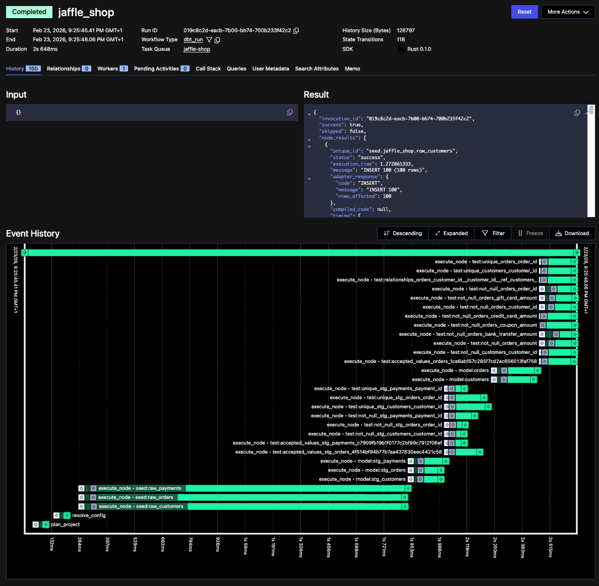
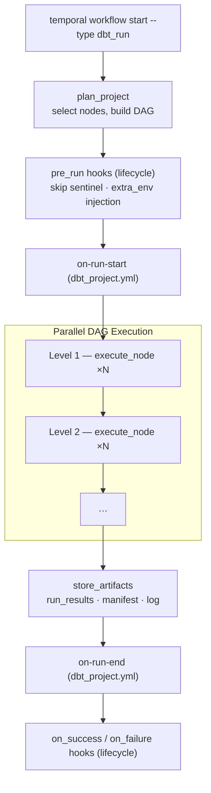

<h1 align="center">dbt-temporal</h1>

<p align="center">
  <strong>Run dbt on Temporal.</strong><br>
  A Temporal worker that executes dbt projects as durable workflows, one activity per model.
</p>

<p align="center">
  <a href="https://github.com/thejens/dbt-temporal/actions/workflows/ci.yml"></a>
  <a href="https://github.com/thejens/dbt-temporal/releases/latest"></a>
  <a href="https://github.com/thejens/dbt-temporal/pkgs/container/dbt-temporal"></a>
  <a href="charts/dbt-temporal/README.md"></a>
  <a href="LICENSE"></a>
</p>

<p align="center">
  <a href="#quick-start">Quick start</a> ·
  <a href="#installation">Installation</a> ·
  <a href="#features">Features</a> ·
  <a href="docs/README.md">Documentation</a> ·
  <a href="charts/dbt-temporal/README.md">Helm chart</a> ·
  <a href="examples/README.md">Examples</a>
</p>

---

**dbt-temporal** is an open-source [Temporal](https://temporal.io/) worker, written in Rust, that runs [dbt](https://www.getdbt.com/) projects as durable Temporal workflows. Every model, test, seed and snapshot is its own Temporal activity, so a `dbt build` gets parallel execution across workers, per-node retries, crash recovery and live progress in the Temporal UI. Runs are started, scheduled and chained like any other Temporal workflow.

It embeds [dbt v2](https://github.com/dbt-labs/dbt), the Rust rewrite of dbt, as a library. There is no Python and no dbt CLI to install: the worker parses your project once at startup and then executes SQL against your warehouse through dbt's own adapters.



> [!NOTE]
> **Project status: proof of concept, not production-ready.** dbt-temporal builds on two stable, generally available releases: [dbt v2](https://github.com/dbt-labs/dbt) (pinned to `v2.0.11`) and the [Temporal Rust SDK](https://github.com/temporalio/sdk-rust) (`1.2.0`). dbt v2's crates are an internal API rather than a published library, though, and several [workarounds](docs/workarounds.md) are needed to run them in a long-lived worker. The project is largely developed with [Claude Code](https://claude.ai/claude-code) and comes with no guarantees of code quality.

## Why run dbt on Temporal

- **Runs that survive restarts.** A run's state lives in Temporal, not in a process. Kill a worker mid-build and the run continues on another one: finished nodes stay finished, and only the nodes that were in flight run again.
- **Retries per node, not per job.** A transient warehouse error retries one model, with backoff, instead of failing the whole `dbt build`.
- **One orchestrator.** Teams already on Temporal can schedule, trigger and chain dbt runs with the tooling they use for every other workflow, and hook any Temporal workflow, in any language, in before or after a run.
- **Scale by adding workers.** Independent models in a DAG level run in parallel across every worker on the task queue. On Kubernetes, KEDA scales workers on queue backlog, down to zero.
- **See what is happening.** Each node is a named activity in the Temporal UI timeline, with live status, search attributes and a CLI-style run log.

## How it works



1. At startup the worker loads one or more dbt projects, from a local directory, a git repository, S3 or GCS, and parses them once.
2. Starting a `dbt_run` workflow plans the run: it applies `--select` / `--exclude` and sorts the DAG into levels of independent nodes.
3. Each level fans out as Temporal activities, one per node. An activity renders the node's materialization with dbt's Jinja engine, which executes the SQL in your warehouse.
4. Results, `run_results.json`, `manifest.json` and a run log are written to the artifact store.

The full lifecycle, with hooks and project checks, is in [architecture](docs/architecture.md).

## Quick start

You need Docker and the [Temporal CLI](https://docs.temporal.io/cli) (`brew install temporal`).

**Run your own dbt project.** From the project directory, with `profiles.yml` next to `dbt_project.yml`:

```bash
# 1. A local Temporal server (UI at http://localhost:8233)
temporal server start-dev --ip 0.0.0.0

# 2. The worker, with the project mounted read-only
docker run --rm \
  -v "$PWD:/dbt/project:ro" \
  -e DBT_PROJECT_DIRS=/dbt/project \
  -e DBT_PROFILES_DIR=/dbt/project \
  -e TEMPORAL_ADDRESS=host.docker.internal:7233 \
  ghcr.io/thejens/dbt-temporal:latest

# 3. dbt build, as a workflow
temporal workflow start --type dbt_run --task-queue dbt-tasks --input '{"command": "build"}'
```

Open the Temporal UI to watch each model run as an activity. On Linux, add `--add-host=host.docker.internal:host-gateway` to `docker run`. Postgres profiles also need `-e DBT_ALLOW_EXPERIMENTAL_ADAPTERS=true` ([why](docs/configuration.md#dbt-project-discovery)).

**Or run the bundled examples** from a clone of this repository, which start Postgres, Temporal and several workers, then submit workflows:

```bash
make run-examples
```

The [examples walkthrough](examples/README.md) covers single and multi-project workers, BigQuery, and per-workflow environment overrides.

## Installation

Each tagged release publishes a Helm chart, container images and distro packages, for `linux/amd64` and `linux/arm64`.

| Method | Command |
|--------|---------|
| **Kubernetes (Helm)** | `helm install dbt oci://ghcr.io/thejens/charts/dbt-temporal` — see the [chart README](charts/dbt-temporal/README.md) |
| **Container, debian-slim** | `docker pull ghcr.io/thejens/dbt-temporal:latest` — has `git` and a shell |
| **Container, distroless** | `docker pull ghcr.io/thejens/dbt-temporal:distroless` — minimal, no shell |
| **Debian / Ubuntu** | `sudo apt install ./dbt-temporal_<version>_amd64.deb` from the [latest release](https://github.com/thejens/dbt-temporal/releases/latest) (or `_arm64`) |
| **RHEL / Alma / Rocky 8+** | `sudo dnf install ./dbt-temporal-<version>-1.x86_64.rpm` from the [latest release](https://github.com/thejens/dbt-temporal/releases/latest) (or `.aarch64`) |
| **From source** | `cargo install --git https://github.com/thejens/dbt-temporal --locked` |

A minimal Helm install:

```bash
helm install dbt oci://ghcr.io/thejens/charts/dbt-temporal \
  --set temporal.address=temporal-frontend.temporal:7233 \
  --set dbt.projectDirs='git+https://github.com/org/dbt-models.git#main' \
  --set dbt.profiles.existingSecret=dbt-profiles
```

Both images are glibc-based, so the ADBC warehouse drivers dbt loads at runtime work in either. dbt-temporal is not on crates.io: it depends on dbt v2's crates, which dbt does not publish, through git and a `[patch.crates-io]` block, and `cargo publish` rejects both.

For production setups (Temporal Cloud, health checks, graceful shutdown, read-only filesystems, autoscaling) see [deployment](docs/deployment.md).

## Features

### Execution

- **Parallel DAG execution.** Nodes at each dependency level run concurrently as Temporal activities, with automatic retries for transient adapter errors.
- **All the dbt commands a scheduler needs.** `build`, `run`, `test`, `seed`, `snapshot`, `compile`, `list`, `source-freshness` and `freshness`, with `--select` / `--exclude`, `--target`, `--vars`, `--full-refresh` and `--fail-fast` as [workflow input](docs/workflow-input.md).
- **Slim CI, defer and retry.** `state:` selectors against a previous manifest, `--defer` to production relations, and re-running only the nodes that failed in an earlier run.
- **Runs of any size.** A run that outgrows Temporal's history limit continues as a new execution on its own, keeping one identity and one set of artifacts.
- **Live control.** Query progress and toggle fail-fast on a running workflow.

### dbt compatibility

- **Full hook parity.** `on-run-start` / `on-run-end` with the standard `results` context, and per-model `pre-hook` / `post-hook`.
- **Selectors.** 20 of dbt's 24 selector methods, with dbt's own glob rules. Methods that need artifacts the worker does not have (`result:`, `source_status:`) are rejected by name rather than silently matching nothing. See [selector semantics](docs/selector-semantics.md).
- **Unit tests.** `unit_tests:` run as activities in `dbt build`, against `given` fixtures (dict, CSV or SQL). A unit test runs before its model, and a failure skips the model and everything downstream.
- **Freshness.** `source-freshness` measures sources; `freshness` also measures models that declare a freshness SLA. A node past `error_after` fails the run, and results are written to `sources.json`.
- **Project checks.** SQL under `check-paths` queries the project's own metadata (`dbt.models`, `dbt.checks`, …) and gates the build before any hook or model runs.
- **`store_failures` and `catalog.json`.** Failing test rows persist to the audit schema; `WRITE_CATALOG=1` adds a partial `catalog.json` to each run's artifacts.
- **Multi-adapter targets.** A profile target may declare several adapters; each node is routed by its `+adapter` selection. Per-node selection is experimental in dbt and needs `DBT_ENGINE_EXPERIMENTAL_MULTI_ADAPTER=true`.
- **Functions.** dbt v2 scalar UDFs are built like any other node.

### Platform

- **Multi-project workers.** Load several dbt projects into one worker and pick one per workflow.
- **Remote project sources.** Fetch projects at startup from git (`git+https://`, `git+ssh://`, pinned to a commit), S3 or GCS, including private repositories.
- **Per-workflow environment overrides.** Each workflow can override `env_var()` values, including the ones `profiles.yml` reads, so one worker serves many warehouses, schemas or tenants in parallel. See [env overrides](docs/env-overrides.md).
- **Lifecycle hooks.** `pre_run`, `on_success` and `on_failure` start arbitrary Temporal child workflows, in any language, for validation, notifications, catalog updates or conditional skipping. See [hooks](docs/hooks.md).
- **Artifact storage.** `run_results.json`, `manifest.json` and a CLI-style run log on local disk, S3 or GCS.
- **Observability.** Live node status in workflow memos, per-node activity names in the timeline, search attributes for filtering runs, Prometheus metrics and OpenTelemetry export.

### Operations

- **Kubernetes-native.** A [Helm chart](charts/dbt-temporal/README.md) with a non-root pod on a read-only root filesystem, startup and liveness probes, a PodDisruptionBudget, a ServiceMonitor and a KEDA `ScaledObject`. Every release is tested end to end on k3d before it is published.
- **Graceful shutdown.** On `SIGTERM` the worker stops polling and lets in-flight models finish, or cancels and hands them to another worker after a deadline.
- **Safe deploys.** Worker deployment versioning pins each run to the build that started it.
- **Worker tuning.** Fixed concurrency caps or resource-based slot tuning (cgroup-aware), rate limits and poller autoscaling.
- **Temporal Cloud.** API key or mTLS authentication.

## Supported warehouses

dbt-temporal runs SQL through dbt v2's adapters and adds no warehouse code of its own.

| Warehouse | Status |
|-----------|--------|
| PostgreSQL | Covered by this repository's integration tests and the Helm chart's end-to-end test. dbt marks the adapter experimental, so set `DBT_ALLOW_EXPERIMENTAL_ADAPTERS=true`. |
| DuckDB | Covered by this repository's scenario tests. |
| BigQuery | Covered by opt-in integration tests and an [example](examples/README.md). |
| Snowflake, Databricks, Redshift, ClickHouse, Salesforce | Supported by dbt v2; not exercised by this repository's tests. |

## Starting a run

A run is one execution of the `dbt_run` workflow. Its input mirrors the dbt CLI:

```bash
temporal workflow start --type dbt_run --task-queue dbt-tasks --input '{
  "command": "build",
  "select": "+my_model",
  "exclude": "tag:wip",
  "target": "prod",
  "full_refresh": false,
  "fail_fast": true,
  "vars": {"key": "value"},
  "env": {"DB_SCHEMA": "prod_analytics"}
}'
```

All fields are optional; `command` defaults to `build`. The [workflow input reference](docs/workflow-input.md) covers every field, the commands, slim CI, retrying a failed run, scheduling with Temporal Schedules, and querying a run while it executes:

```bash
temporal workflow query -w <workflow-id> --type run_status
temporal workflow update execute -w <workflow-id> --name set_fail_fast -i true
```

## Documentation

| Document | Contents |
|----------|----------|
| [Workflow input](docs/workflow-input.md) | Every `dbt_run` input field, the supported commands, slim CI, retry and scheduling |
| [Configuration](docs/configuration.md) | Environment variables: Temporal connection, project discovery, artifact storage, search attributes, worker tuning, observability |
| [Deployment](docs/deployment.md) | Container images, Kubernetes, Cloud Run, ECS, Azure; health checks, graceful shutdown, Temporal Cloud |
| [Helm chart](charts/dbt-temporal/README.md) | Chart values and recipes for Kubernetes: `oci://ghcr.io/thejens/charts/dbt-temporal` |
| [Hooks](docs/hooks.md) | dbt project hooks and Temporal lifecycle hooks: events, error policies, skipping a run, injecting env |
| [Per-workflow env overrides](docs/env-overrides.md) | How `env` overrides reach model SQL, macros and database connections |
| [Error handling](docs/error-handling.md) | Error classification, retries, cancellation, timeouts and history size |
| [Architecture](docs/architecture.md) | Run lifecycle, module layout and dependencies |
| [Examples](examples/README.md) | Walkthrough of the bundled example projects |
| [dbt v2 workarounds](docs/workarounds.md) | Upstream issues and the workarounds in place |
| [Releasing](docs/releasing.md) | Cutting a release and what the release workflow publishes |

## FAQ

**Do I need Python or the dbt CLI?**
No. dbt v2 is compiled into the worker binary. The warehouse drivers are downloaded by dbt on first use.

**Does it run my existing dbt project?**
It runs what dbt v2 runs. dbt v2 is stricter than dbt Core 1.x, so check your project against [dbt's own documentation](https://docs.getdbt.com/) first; `dbt_project.yml`, `profiles.yml`, models and macros are used as they are.

**How is this different from running `dbt build` inside a single Temporal activity?**
A single activity retries the whole build and shows one opaque step. dbt-temporal plans the DAG in the workflow, so each node retries, heartbeats and reports on its own, a crashed worker loses only the nodes it was running, and the project is parsed once per worker instead of once per run.

**Does it work with Temporal Cloud?**
Yes, with an API key or mTLS. See [deployment](docs/deployment.md#temporal-cloud).

**How do I schedule runs?**
With [Temporal Schedules](https://docs.temporal.io/schedule), or by starting `dbt_run` from another workflow. See [scheduling](docs/workflow-input.md#scheduling).

**Can one worker serve several projects or environments?**
Yes. A worker can load several projects, and each workflow can override `target` and `env_var()` values, including warehouse credentials.

## License

dbt-temporal is [MIT-licensed](LICENSE). Its two main dependencies are permissively licensed as well: dbt v2 is Apache 2.0 and the Temporal Rust SDK is MIT. See [THIRD-PARTY-LICENSES.md](THIRD-PARTY-LICENSES.md); every release artifact ships the full license texts.

## Contributing and development

**Prerequisites**: Rust 1.96+, `protoc`, Docker + Docker Compose, and the [Temporal CLI](https://docs.temporal.io/cli) (`brew install temporal`) for the examples.

```bash
make run-examples       # one-command demo: Postgres + Temporal + workers + workflows
make test               # cargo test
make lint               # cargo fmt --check + cargo clippy
```

Integration tests use [testcontainers](https://rust.testcontainers.org/) to spin up Postgres and Temporal in Docker:

```bash
cargo test --test waffle_hut                    # end-to-end test
cargo test --features aws --test artifact_store_s3  # S3 artifact store against RustFS
```

### Docker

```bash
docker build -f docker/Dockerfile -t dbt-temporal .
docker run -v ./my-project:/dbt/project:ro \
  -e DBT_PROJECT_DIRS=/dbt/project \
  -e DBT_PROFILES_DIR=/dbt/project \
  -e TEMPORAL_ADDRESS=host.docker.internal:7233 \
  dbt-temporal
```
