# Architecture: How dbt Runs as a Temporal Workflow

dbt-temporal runs a dbt project as a Temporal workflow. The worker parses the
project once at startup; each run is a `dbt_run` workflow that plans the DAG,
then executes every model, test, seed and snapshot as its own Temporal
activity, level by level. This page covers the run lifecycle, the module
layout and the dependencies.

```mermaid
flowchart TD
    User["temporal workflow start\n--type dbt_run --input '{...}'"] --> Workflow

    subgraph Workflow["dbt_run Workflow (deterministic)"]
        direction TB
        W1["1. plan_project activity"] --> W2["2. resolve_config activity"]
        W2 --> W3["3. run_project_checks (if the project has checks)"]
        W3 --> W4["4. Run pre_run lifecycle hooks"]
        W4 --> W5["5. run_project_hooks (on-run-start)"]
        W5 --> W6["6. For each topological level:\n   fan-out execute_node"]
        W6 --> W7["7. store_artifacts activity"]
        W7 --> W8["8. run_project_hooks (on-run-end)"]
        W8 --> W9["9. Run on_success / on_failure lifecycle hooks"]
        W9 --> W10["10. Return DbtRunOutput"]
    end

    Workflow --> Activities

    subgraph Activities["Activities (non-deterministic, all I/O here)"]
        direction LR
        Plan["**plan_project**\nSelect nodes\nBuild DAG\nTopo levels\nManifest"]
        Config["**resolve_config**\nLoad dbt_temporal.yml\nHook + retry config"]
        Checks["**run_project_checks**\nEvaluate checks/\nagainst project metadata"]
        Hooks["**run_project_hooks**\nRender on-run-start /\non-run-end Jinja"]
        Exec["**execute_node**\nJinja render\n(execute=true via\nBridgeAdapter)\nperiodic heartbeat"]
        Store["**store_artifacts**\nrun_results.json\nmanifest.json\nlog.txt"]
    end
```

**Key insight**: dbt node execution IS Jinja rendering with `execute=true`. Materialization macros (table, view, incremental) generate DDL/DML. The `BridgeAdapter` routes Jinja `adapter.*` calls to the real warehouse.

## How It Works

1. **Worker startup**: Optionally fetches dbt projects from a remote model store (git repo or cloud storage). Then loads one or more dbt projects (dbt-loader -> dbt-parser -> one adapter engine per adapter the project's target declares) into a `ProjectRegistry`. Each project gets its own `WorkerState` with isolated adapter connections.

2. **`plan_project` activity**: Applies `--select`/`--exclude` filters, builds topological levels from the DAG, and serializes the manifest.

3. **`resolve_config` activity**: Loads `dbt_temporal.yml` from the project directory (if present) and returns the resolved hook and retry configuration for this run.

4. **`run_project_checks` activity**: If the project declares checks under `check-paths` (`checks/` by default), evaluate every one of them against the metadata written at startup and stop the run if any is fatal. Scheduled only when the project has checks, and placed before the hooks so a project that fails its gate performs no side effects on the way to finding out. See [Project checks](#project-checks).

5. **`pre_run` lifecycle hooks**: Child workflows declared in `dbt_temporal.yml` that run before any SQL. They can skip the run or inject extra env vars into it. See [hooks](hooks.md).

6. **`run_project_hooks` activity (`on-run-start`)**: If `dbt_project.yml` declares `on-run-start`, render those Jinja templates against the full compile+run context (with `execute=true` and per-workflow env overrides applied). Failure aborts the run before any node executes.

7. **`execute_node` activity** (per node, per level): Clones the Jinja environment, configures it for the run phase with `execute=true`, renders the node's materialization template. The rendering itself triggers SQL execution through the BridgeAdapter. A periodic heartbeat ticker runs alongside the work so the Temporal UI's last-heartbeat stays current and dead workers are detected within `heartbeat_timeout`.

8. **`store_artifacts` activity**: Writes `run_results.json`, `manifest.json`, and optionally `log.txt` (a CLI-style run log) to the configured artifact store (local filesystem or GCS/S3).

9. **`run_project_hooks` activity (`on-run-end`)**: Always fires (even after failure), with the standard `results` Jinja list populated from `node_results`. Errors are recorded in `DbtRunOutput.hook_errors` but do not flip the run's success status.

10. **`on_success` / `on_failure` lifecycle hooks**: Child workflows that receive the run's output — notifications, downstream triggers. See [hooks](hooks.md).

Parallel execution is natural: all nodes in the same topological level are independent, so Temporal dispatches them as concurrent activities.

## Project checks

A project check is a SQL file under `check-paths` (`checks/` by default) that
queries the project's own metadata rather than the warehouse: `dbt.models`,
`dbt.checks`, `dbt.node_columns` and the rest of the `dbt.*` vocabulary. A
project declaring checks must pin that vocabulary with `info_schema.version` in
`dbt_project.yml`.

Those relations are views over parquet, not warehouse tables. The worker writes
the parse epochs once per project at startup, inside `initialize_project`, under
`<root>/private/metadata/parse/`; each check runs in a throwaway DuckDB where
dbt's own parse-safe view definitions read them directly. Their only input is
the resolved project, which this worker parses once and holds for its lifetime
— so nothing a workflow does can invalidate them, and the per-run gate is a
pure read.

**Verdicts.** A check reports `pass`, `fail`, `warn`, `error` or `skipped`.
`fail` and `error` stop the run; `warn` reports its rows and lets the build
proceed. A check that cannot execute is an `error` whatever its declared
severity — what it would have found is unknown, so anything else would be a
guess.

**Scoping.** A run's selection scopes each check's *rows*; it never decides
whether a check runs. Scoping applies only when the run actually named
`--select` or `--exclude`: an unselected run's default node set is not a
statement about which violations matter, and a check keyed on groups or macros
would otherwise have every violation filtered away into a vacuous pass. When a
scope matches nothing a check can report on, the verdict is `skipped` rather
than `pass` — a green result must not stand in for a check that examined
nothing.

## Project Structure

| File | Description |
|------|-------------|
| [`src/main.rs`](../src/main.rs) | Worker binary entry point |
| [`src/lib.rs`](../src/lib.rs) | Re-exports |
| [`src/error.rs`](../src/error.rs) | `DbtTemporalError` → `ActivityError` mapping |
| [`src/worker_state.rs`](../src/worker_state.rs) | `WorkerState` (holds parsed project) |
| [`src/project_registry.rs`](../src/project_registry.rs) | Multi-project registry + lookup |
| [`src/hooks.rs`](../src/hooks.rs) | Lifecycle hooks (child workflows) |
| [`src/health.rs`](../src/health.rs) | Health file tracker + HTTP health server |
| [`src/dbt_pool.rs`](../src/dbt_pool.rs) | The thread pool all dbt Jinja and warehouse work runs on (dbt keeps connections in its threads' thread-locals) |
| [`src/tracing_setup.rs`](../src/tracing_setup.rs) | Process-wide tracing init; both stacks carry dbt's `TelemetryDataLayer` |
| **Config** (`src/config/`) | |
| [`mod.rs`](../src/config/mod.rs) | `DbtTemporalConfig`, `WorkerTuningConfig` (from env vars) |
| [`discovery.rs`](../src/config/discovery.rs) | Project directory discovery + remote source detection |
| [`tuning.rs`](../src/config/tuning.rs) | Search attribute + worker tuning env var parsing |
| **Types** (`src/types/`) | |
| [`workflow.rs`](../src/types/workflow.rs) | Serializable workflow I/O types (`DbtRunInput`, `DbtRunOutput`, `ExecutionPlan`, …) |
| [`hooks.rs`](../src/types/hooks.rs) | Hook and retry config types (`HooksConfig`, `RetryConfig`, …) |
| [`checks.rs`](../src/types/checks.rs) | Project-check gate payloads |
| **Worker** (`src/worker/`) | |
| [`mod.rs`](../src/worker/mod.rs) | `build_worker`, `run_worker`, project initialization, Temporal registration |
| [`adapter.rs`](../src/worker/adapter.rs) | `build_adapter_engine`, `build_adapter_engines`, `build_artifact_store` |
| [`engines.rs`](../src/worker/engines.rs) | `AdapterEngines` — the per-adapter engine registry nodes route through |
| [`profile/mod.rs`](../src/worker/profile/mod.rs) | `rebuild_adapter_engines_with_env` (per-workflow env overrides) |
| [`profile/render.rs`](../src/worker/profile/render.rs) | Re-rendering `profiles.yml` with a workflow's env map |
| [`temporal.rs`](../src/worker/temporal.rs) | TLS options, worker identity, worker config construction |
| [`shutdown.rs`](../src/worker/shutdown.rs) | Graceful shutdown on `SIGTERM` / `SIGINT` |
| [`project_checks.rs`](../src/worker/project_checks.rs) | Writes the metadata project checks read, once per project at startup |
| [`defer_cache.rs`](../src/worker/defer_cache.rs) | Decoded `--defer` manifests, shared across a run's activities |
| [`schemas.rs`](../src/worker/schemas.rs) | Target schemas already created, per run |
| **Workflow** (`src/workflow/`) | |
| [`mod.rs`](../src/workflow/mod.rs) | `dbt_run_workflow` |
| [`phases.rs`](../src/workflow/phases.rs) | One helper per run phase (plan, hooks, checks, artifacts, continue-as-new) |
| [`levels.rs`](../src/workflow/levels.rs) | The level loop: fan-out, fail-fast and dependency skipping |
| [`search_attributes.rs`](../src/workflow/search_attributes.rs) | Typed search-attribute updates |
| [`helpers.rs`](../src/workflow/helpers.rs) | Node status tree, retry policy, log helpers |
| **Activities** (`src/activities/`) | |
| [`mod.rs`](../src/activities/mod.rs) | `DbtActivities` — `Arc<Self>` shared state, `#[activities]` registration |
| [`plan.rs`](../src/activities/plan.rs) | `plan_project` — select nodes, build DAG levels, serialize manifest |
| [`execute_node.rs`](../src/activities/execute_node.rs) | `execute_node` — compile + render a single node; [`execute_node/`](../src/activities/execute_node/) holds freshness, unit tests and SQL rewriting |
| [`render_env.rs`](../src/activities/render_env.rs) | Per-activity Jinja environment + adapter setup |
| [`retry.rs`](../src/activities/retry.rs) | Retry classification at the activity boundary |
| [`project_checks/`](../src/activities/project_checks/) | `run_project_checks` — the project-check gate |
| [`project_hooks.rs`](../src/activities/project_hooks.rs) | `run_project_hooks` — render `on-run-start` / `on-run-end` from `dbt_project.yml` |
| [`store_artifacts.rs`](../src/activities/store_artifacts.rs) | `store_artifacts` — write run results + manifest |
| [`catalog.rs`](../src/activities/catalog.rs) | `catalog.json` generation (`WRITE_CATALOG`) |
| [`segment_state.rs`](../src/activities/segment_state.rs) | Run state handed across a continue-as-new boundary |
| [`heartbeat.rs`](../src/activities/heartbeat.rs) | Periodic `record_heartbeat` ticker for long-running activities |
| [`node_helpers.rs`](../src/activities/node_helpers.rs) | Materialization template lookup + rendering helpers |
| [`node_serialization.rs`](../src/activities/node_serialization.rs) | Serialization helpers for passing nodes across activity boundaries |
| [`dag.rs`](../src/activities/dag.rs) | DAG construction and topological level computation |
| [`selectors/`](../src/activities/selectors/) | Node selector evaluation (`--select` / `--exclude`) |
| [`indirect.rs`](../src/activities/indirect.rs) | Indirect test selection (a selected model's tests join the run) |
| [`node_telemetry.rs`](../src/activities/node_telemetry.rs) | dbt-native telemetry spans per node |
| **Artifact Store** (`src/artifact_store/`) | |
| [`mod.rs`](../src/artifact_store/mod.rs) | `ArtifactStore` trait |
| [`local.rs`](../src/artifact_store/local.rs) | Local filesystem backend |
| [`object_store_backend.rs`](../src/artifact_store/object_store_backend.rs) | GCS/S3 via `object_store` (feature-gated) |
| **Model Store** (`src/model_store/`) | |
| [`mod.rs`](../src/model_store/mod.rs) | `fetch_models` entry point |
| [`git.rs`](../src/model_store/git.rs) | Git clone backend |
| [`local.rs`](../src/model_store/local.rs) | Local directories; stages a copy when dbt would need to write to a read-only one |
| [`object_store_backend.rs`](../src/model_store/object_store_backend.rs) | GCS/S3 download backend (feature-gated) |

## Dependencies

| Dependency | Status | Role |
|------------|--------|------|
| [Temporal Rust SDK](https://github.com/temporalio/sdk-rust) | `1.2.0`, stable (GA) | Workflow orchestration |
| [dbt v2](https://github.com/dbt-labs/dbt) | `v2.0.11` release, stable (GA), pinned by git rev in [Cargo.toml](../Cargo.toml) — the crates are not published | Project loading, parsing, DAG construction, Jinja rendering, adapter execution |
